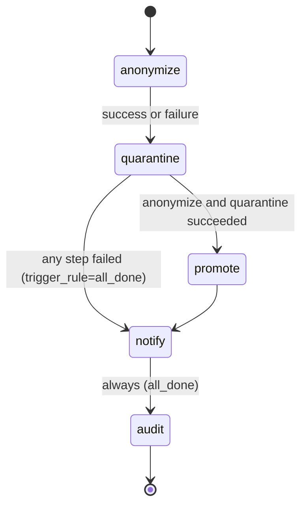
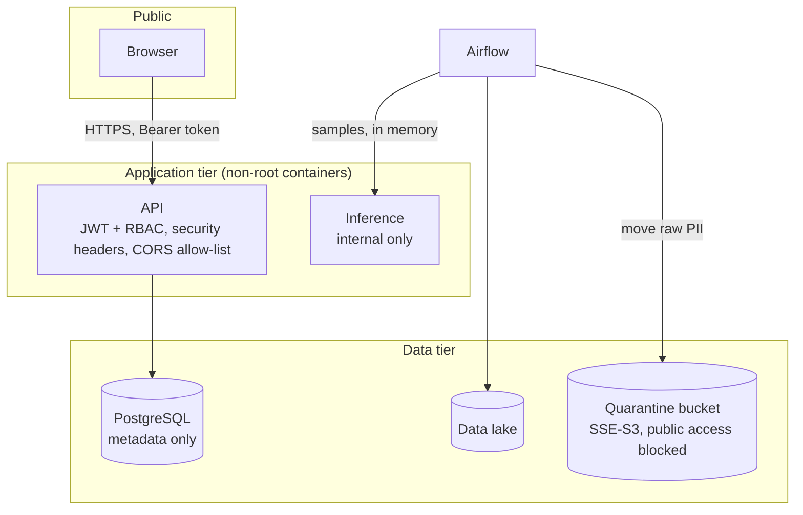

# Architecture

This document describes how the platform is built today: its components, how data moves between them, what is stored, and where the security boundaries are. For the reasoning behind each technology choice, see [engineering-decisions.md](engineering-decisions.md) and the original design record in [planning/DECISIONS.md](../planning/DECISIONS.md).

---

## 1. System overview

The platform is event-driven. It never scans a data lake on a fixed sweep: every new table or file is announced on Kafka, inspected once, and then either cleared or remediated.

```mermaid
flowchart LR
    subgraph Sources
        GLUE[Glue / Athena<br/>table.created]
        S3EV[S3 EventBridge<br/>file.moved]
    end

    subgraph Scanner
        C1[table_created_consumer]
        C2[file_moved_consumer]
        DLQ[(topic.dlq)]
        P[pii_candidate_producer]
    end

    subgraph Airflow
        PATROL[patrol_new_tables<br/>@daily]
        SAMPLE[sampling_pipeline]
        REM[remediation]
        EXP[quarantine_expiry<br/>06:00 daily]
    end

    INF[PII inference service<br/>DistilBERT, :8001]
    PG[(PostgreSQL)]
    API[FastAPI, :8000]
    UI[React dashboard, :5173]
    QB[(S3 quarantine bucket)]
    DPO[DPO: email / Slack]

    GLUE --> C1
    S3EV --> C2
    C1 & C2 -->|valid| PG
    C1 & C2 -->|malformed| DLQ
    C1 & C2 --> P -->|pii.candidates, Avro| PATROL
    PATROL --> SAMPLE
    SAMPLE -->|column samples| INF
    INF -->|findings| PG
    SAMPLE -->|flagged S3 object| REM
    REM --> QB
    REM --> DPO
    REM --> PG
    EXP --> QB
    EXP --> DPO
    PG --> API --> UI
```

| Layer | Path | Runtime | Responsibility |
|---|---|---|---|
| Ingestion | `scanner/` | Python, kafka consumers | Validate events, persist `scanner_events`, publish `pii.candidates` (Avro), route poison messages to `<topic>.dlq` |
| Orchestration | `orchestration/dags/`, `orchestration/plugins/` | Airflow 2.8.1 (Python 3.11) | Patrol, sampling, classification, remediation and retention DAGs; S3 and Athena samplers |
| Classification | `ml/inference/` | FastAPI + transformers, CPU by default | Column-level PII classification |
| Training | `ml/data/`, `ml/training/` | transformers Trainer + mlflow | Synthetic data, fine-tuning, evaluation, registry publishing |
| Remediation | `etl/` | PySpark + boto3 | Anonymize, quarantine, notify |
| API | `api/` | FastAPI, SQLAlchemy 2 async + asyncpg | Risk inventory, compliance, DSAR, audit, auth |
| UI | `dashboard/` | React 18, TypeScript, Vite 7, TanStack Query, Zustand | DPO dashboard |
| Schema | `alembic/` | Alembic | Migrations `0001`–`0008` |
| Infra | `infra/` | Terraform, Helm, Grafana, PagerDuty | AWS resources, Kubernetes charts, dashboards, alerts |

---

## 2. Pipeline, step by step

### 2.1 Detection (scanner)

1. `table_created_consumer` and `file_moved_consumer` read their Kafka topics. Both extend `BaseConsumer`.
2. Each payload is parsed into a pydantic event (`scanner/schemas/events.py`). A payload that fails to parse, including one that raises `TypeError` or `AttributeError` inside the parser, is sent to `<topic>.dlq` and committed. It never crash-loops the consumer.
3. Valid events are written to `scanner_events` with `ON CONFLICT (event_id) DO NOTHING`, so redelivered messages are harmless.
4. `pii_candidate_producer` publishes a `pii.candidates` record using the Avro schema in `scanner/schemas/avro/pii_candidate.avsc`.

### 2.2 Sampling and classification

`patrol_new_tables` runs daily. It picks up unscanned events and triggers one `sampling_pipeline` run per table. A run that already exists (`DagRunAlreadyExists`) counts as success, so retries do not fail.

`sampling_pipeline` then:

1. Samples up to **1,000 rows**, using `S3Sampler` for parquet/csv/json objects or `AthenaSampler` for catalog tables. Athena identifiers are validated against a strict regex and quoted, and results are paged with `NextToken`.
2. Persists the samples to `column_samples`.
3. Only after the samples are persisted, `PIIClassifierOperator` sends `column name + sample values` to the inference service and upserts one `pii_findings` row per column (`ON CONFLICT (scanner_event_id, column_name)`).
4. Writes the audit record.
5. Triggers `remediation` if any column has confidence ≥ `MODEL_CONFIDENCE_THRESHOLD` (0.85). It passes `source_s3_path`, `source_format`, `flagged_columns` and `owner_email`. Only S3 objects of a known format are sent for automatic remediation. Catalog tables are reported to the DPO.

### 2.3 Remediation

The steps are **strictly sequential**, because anonymization and quarantine both touch the same S3 path.



| Step | What it does | Guarantee |
|---|---|---|
| `anonymize` | Spark reads the source, applies the per-category strategy to each flagged column, and writes to a **staging prefix** in the same format | Refuses to write over its own input |
| `quarantine` | Copies the raw object(s) to the quarantine bucket (SSE-S3) and records them in `quarantine_manifest`. Exact-prefix match only, so `data/users` never sweeps `data/users_backup` | Runs even if anonymization failed: raw PII is always contained |
| `promote` | Moves the anonymized copy back to the original location | Only after both previous steps succeeded; no partial output is promoted |
| `notify` | Email (STARTTLS when offered) and/or Slack to the DPO | Always runs; null-safe when upstream data is missing |
| `audit` | Appends `remediation_completed` or `remediation_failed` to `audit_log` | Always runs |

Anonymization strategies (`etl/anonymizers/strategies.py`):

| Category | Strategy |
|---|---|
| EMAIL | SHA-256 hash (preserves joins) |
| CREDIT_CARD | Keep last 4 digits |
| SSN, BANK_ACCOUNT, PASSPORT | `[REDACTED]` |
| FULL_NAME | Format-preserving pseudonym |
| PHONE | Keep country code, mask the rest |
| DATE_OF_BIRTH | Year only |
| ADDRESS | Keep city/state, drop street |

### 2.4 Retention

`quarantine_expiry` runs daily at 06:00.

- It warns owners 7 days before deletion and sets `warning_sent_at` so each warning is sent once.
- It deletes quarantined objects after 30 days and sets `expired_at`.

Both windows are configurable (`QUARANTINE_RETENTION_DAYS`, `QUARANTINE_WARNING_DAYS_BEFORE`). A lifecycle rule on the quarantine bucket's `pending/` prefix (Terraform) is a second line of defense if the DAG stops running: objects move to Glacier at 23 days and are deleted at 30.

---

## 3. ML model

| Item | Value |
|---|---|
| Base model | `distilbert-base-multilingual-cased` (overridable with `MODEL_BASE`) |
| Labels | 9 PII categories + `NONE`: ADDRESS, BANK_ACCOUNT, CREDIT_CARD, DATE_OF_BIRTH, EMAIL, FULL_NAME, PASSPORT, PHONE, SSN |
| Input | `column_name` concatenated with sample values, max 128 tokens |
| Training data | Synthetic (Faker), 10,000 samples per label across `en_US`, `es_MX`, `pt_BR` |
| Training defaults | 5 epochs, batch 32, learning rate 2e-5, seed 42 |
| Quality gate | Macro F1 ≥ 0.90 (`train.py` warns below it); `evaluate.py` reports per-class recall at the 0.85 threshold |
| Registry | mlflow transformers flavor (safetensors + tokenizer), registered as `pii-classifier` |
| Serving | `ml/inference/app.py`. Loads once at startup (`lifespan`), one batched forward pass per request, sync endpoint so CPU work does not block the event loop |
| Model source | Local directory or `MODEL_S3_PATH` tarball, extracted with `tarfile` `filter="data"` (rejects path traversal) |
| Device | `MODEL_DEVICE=-1` (CPU) or a GPU index |

Training and inference use separate dependency files: `requirements-train.txt` adds mlflow and accelerate on top of `requirements-ml.txt`, so the inference image never carries mlflow.

---

## 4. Data model

PostgreSQL 15 (`pii_hunter` database). Stored values are table names, column names and classification metadata only. **PII values themselves are never persisted.**

| Table | Purpose | Key constraints |
|---|---|---|
| `scanner_events` | One row per detected table/file | Unique `event_id`; `updated_at` trigger |
| `column_samples` | Per-column sample metadata: dtype, sample count, `sample_s3_path`. The sampled rows live in the staging bucket, not in the database | Joined on `(scanner_event_id, column_name)` |
| `pii_findings` | Classification result per column: category, confidence, `flagged`, status | Unique `(scanner_event_id, column_name)` (migration 0008) |
| `quarantine_manifest` | What was moved where, and when | `warning_sent_at`, `expired_at`, partial index on active entries |
| `notifications` | DPO notifications sent | Webhook URLs are never stored |
| `audit_log` | Append-only trail of every action | `trg_audit_log_immutable` blocks UPDATE/DELETE |
| `model_registry` | Deployed model versions and metrics | — |
| `dsar_searches` | DSAR search history | Identifier stored as a keyed HMAC (`DSAR_HASH_KEY`) |
| `ropa_annotations` | DPO-entered purpose, legal basis and cross-border flag per source | Upsert by source name |
| `lineage_edges` | Parent → child copies between tables | Unique edge; insertion counted via `RETURNING` |

---

## 5. API surface

All routes are under `/api/v1` and require a JWT except `/auth/token`. Write operations require the `dpo` or `admin` role.

| Area | Routes |
|---|---|
| Auth | `POST /auth/token` (rate limited: 10 attempts / 60 s per client), `GET /auth/me` |
| Risk inventory | `GET /risks` (status, category, source, date filters, paging), `GET /stats/summary`, `GET /data-sources` |
| Tables | `GET /tables/{id}/pii-report`, `POST /tables/{id}/remediate` |
| Lineage | `GET /tables/{id}/lineage`, `POST /tables/{id}/lineage/infer`, `POST /tables/{id}/lineage/cascade-review` |
| Compliance | `GET /compliance/ropa`, `GET /compliance/ropa/export.csv`, `PATCH /compliance/ropa/{source}`, `GET /compliance/trends`, `GET /compliance/forecast`, `GET /compliance/risk-exposure` |
| DSAR | `POST /dsar/search`, `GET /dsar/searches` |
| Audit | `GET /audit-log`, `GET /audit-log/export` |
| Demo | `POST /demo/seed`, only when `DEMO_MODE=true` |

Every query uses `text()` with named bind parameters. JSON columns are written with `CAST(:p AS jsonb)` and `json.dumps` payloads, never string formatting. CSV exports prefix cells that start with `= + - @` so spreadsheets do not evaluate them.

---

## 6. Security boundaries



- **Identity.** HS256 JWT with the algorithm pinned on decode (PyJWT), four roles (dpo, admin, auditor, viewer), constant-time password comparison. Without `JWT_SECRET_KEY`, the API starts with a development key and logs a warning.
- **Transport.** HSTS is emitted behind an HTTPS proxy. `X-Forwarded-For` is honoured only with `TRUST_PROXY_HEADERS=true`.
- **Data minimisation.** Sampled rows are written under `samples/` in the staging bucket, which a lifecycle rule expires after 7 days. PostgreSQL stores only metadata. Logs carry identifiers and scores, never values (verified by `tests/security/`).
- **Supply chain.** Pinned requirements per component, pip-audit per file, npm audit, and Trivy on every image in CI.

Full OWASP Top 10 review: [security-review.md](security-review.md).

---

## 7. Deployment

| Environment | How |
|---|---|
| Local | `docker-compose.yml`: Kafka + Zookeeper + Schema Registry, PostgreSQL 15, Redis 7, Airflow 2.8.1, API (with `--reload`), inference, dashboard |
| Windows demo | `demo.ps1` (infra + migrations + API + dashboard; `-WithInference` adds the ML service) |
| Cloud | Terraform (`infra/terraform`): VPC with public/private subnets and NAT, EKS, and S3 buckets: data lake, quarantine (lifecycle rules), models, and staging (7-day sample expiry). Helm umbrella chart `pii-ghost-hunter` (API, dashboard, inference with HPA, PrometheusRule) |
| Inference rollout | Separate blue/green chart `pii-inference-bluegreen`; see [runbooks/inference-bluegreen-rollout.md](runbooks/inference-bluegreen-rollout.md) |
| Observability | Prometheus metrics in the scanner, the inference service and the DAG callbacks; Grafana dashboards in `infra/grafana`; PagerDuty rules in `infra/alerting` |

### Container images

| Image | Base | Notes |
|---|---|---|
| API | `python:3.11-slim` | Installs `api/requirements.txt` only, removes setuptools/wheel, user `app` (uid 10001), Python-based healthcheck |
| Inference | `python:3.11-slim` | CPU torch from the PyTorch index, same hardening as the API |
| Dashboard (dev) | `node:20-alpine` | `apk upgrade`, npm 11, `npm ci`, user `node`, `.dockerignore` excludes host `node_modules` and `.env` |

---

## 8. Dependency layout

| File | Used by |
|---|---|
| `requirements.txt` | Core: API, scanner, ETL jobs |
| `api/requirements.txt` | API image |
| `requirements-ml.txt` | torch, transformers, scikit-learn, faker (inference and tests) |
| `requirements-train.txt` | ML + mlflow + accelerate (training workflow only) |
| `requirements-dev.txt` | Core + ML + test/lint tools (`make install`) |

Airflow providers are not pip-installed; they come with the `apache/airflow` image. Airflow 2.8 requires SQLAlchemy < 2 while the API uses SQLAlchemy 2, so the DAG tests run inside the Airflow image (`airflow-test` CI job).
